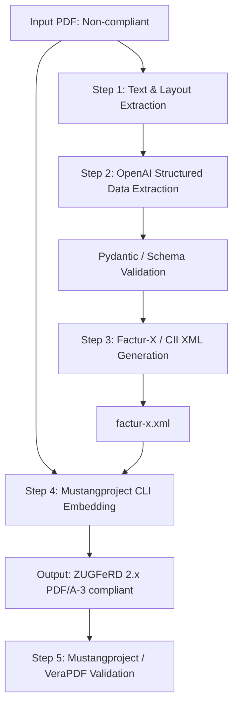

# Implementation Plan: ZUGFeRD / Factur-X PDF/A-3 Conversion Pipeline

This plan outlines the architecture and phased implementation for converting standard invoice PDFs (e.g. `documentsforconversion/C2025012_zig.pdf`) into fully compliant **ZUGFeRD 2.x / Factur-X PDF/A-3** invoices with validated `factur-x.xml` embedded.

---

## 1. Architecture Overview



### Components
1. **Extraction & AI Layer**:
   - Python-based pipeline using `pypdf` / `pdfplumber` (or rendering pages to images for vision if scanned) + OpenAI Structured Outputs (`gpt-4o` / `gpt-4o-mini`).
   - Strong schema adherence to the **EN 16931** / **EXTENDED** / **BASIC** ZUGFeRD profiles (UN/CEFACT Cross Industry Invoice - CII standard).
2. **XML Builder Layer**:
   - Template/builder generating standardized `CrossIndustryInvoice` XML conforming to `urn:un:unece:uncefact:data:standard:CrossIndustryInvoice:100#`.
3. **PDF/A-3 Embedding & Validation Layer**:
   - Mustangproject CLI (`Mustang-CLI.jar`) handles:
     - Embedding `factur-x.xml` as `/AF` with `/AFRelationship /Alternative` and MIME `text/xml`.
     - Injecting XMP metadata extension schema (`urn:factur-x:pdfa:CrossIndustryDocument:invoice:1p0#`).
     - Converting visual PDF to PDF/A-3b conformant format.
     - Validating against Schematron rules (`--action validate`).

---

## 2. Step-by-Step Implementation Phases

### Phase 1: Tooling & Mustangproject Setup
- [ ] Download latest stable `Mustang-CLI.jar` (or configure automated fetch script).
- [ ] Inspect `official_examples/zugferd_2p1_EN16931_Betriebskostenabrechnung.pdf` using Mustang CLI (`--action extract`, `--action validate`) to establish reference baseline schema and profile parameters.
- [ ] Test Java Mustang-CLI execution locally in Windows PowerShell.

### Phase 2: PDF Parsing & OpenAI Structured Extraction
- [ ] Implement PDF pre-processor (supporting digital text extraction and fallback OCR/page images).
- [ ] Define the Pydantic data model matching ZUGFeRD / Factur-X standard fields:
  - Header: Invoice number, issue date, currency, invoice type code (380).
  - Seller & Buyer: Names, addresses, country codes, tax IDs / VAT IDs (e.g., SI/EU VAT IDs), registration numbers.
  - Payment Details: IBAN, BIC, payment terms, due date.
  - Line Items: Description, quantity, unit code (e.g., `C62`, `H87`), net price, VAT rate category, line totals.
  - Tax Breakdown: Basis amounts, tax percentages, category codes (`S`, `E`, `AE`, `Z`), total tax.
  - Grand Totals: Total line net amount, total tax amount, grand total with tax, payable amount.
- [ ] Integrate OpenAI client with function calling / response schema to extract structured JSON from `C2025012_zig.pdf`.

### Phase 3: Factur-X / CII XML Generation
- [ ] Build a robust XML serializer (`factur-x.xml`) using `lxml` or Jinja2 template validated against UN/CEFACT CII 16B schemas.
- [ ] Ensure proper namespace mappings (`rsm`, `ram`, `qdt`, `udt`).
- [ ] Validate generated XML standalone using Mustangproject (`--action validate --source-xml factur-x.xml`).

### Phase 4: PDF/A-3 Embedding & Combination
- [ ] Execute Mustang CLI command:
  ```powershell
  java -jar Mustang-CLI.jar --action combine --source input.pdf --source-xml factur-x.xml --out output_zugferd.pdf --format fx --version 2 --profile EN16931
  ```
- [ ] Verify XMP metadata stream, PDF catalog `/AF` dictionary, and file attachment name (`factur-x.xml`).

### Phase 5: Automated Validation & CLI / UI Wrapper
- [ ] Run automated validation:
  ```powershell
  java -jar Mustang-CLI.jar --action validate --source output_zugferd.pdf
  ```
- [ ] Provide a clean CLI tool or lightweight local web interface (FastAPI / Streamlit / Node) where users can:
  - Upload/select any non-compliant PDF.
  - Review / edit extracted invoice fields (human-in-the-loop review).
  - One-click compile to ZUGFeRD PDF/A-3.
  - View instant Mustang validation report (green/valid or error logs).

---

## 3. Recommended Interface & Workflow

| Option | Description | Target Use Case |
|---|---|---|
| **Option A (Recommended): Python CLI + Web UI (FastAPI/Streamlit)** | Python CLI with reviewable local Web UI allowing visual confirmation of extracted AI data before final PDF/A-3 generation. | Best balance of automation and human verification for invoices. |
| **Option B: Pure CLI / Batch Script** | Direct command-line pipeline: `python convert.py input.pdf --out output.pdf` that runs headless. | Ideal for automated batch processing. |
