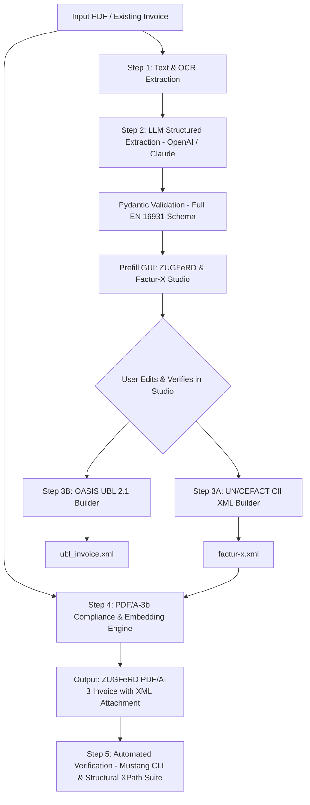

# Implementation Plan: ZUGFeRD / Factur-X & EN 16931 End-to-End Conversion Pipeline

This plan defines the architecture, data models, validation framework, and phased execution for converting arbitrary invoices into fully validated, compliant **ZUGFeRD 2.x / Factur-X PDF/A-3** and **Peppol UBL 2.1** documents, integrated directly with the existing **ZUGFeRD & Factur-X Studio** web interface.

---

## 1. Architecture Overview



### Core Architecture Pillars:
1. **Extraction & Normalization Layer:**
   - Multi-modal ingestion (`pdfplumber` / digital text stream with fallback to vision rendering).
   - Structured JSON output conforming strictly to the unified **EN 16931** semantic model.
2. **Interactive Verification (Human-in-the-Loop):**
   - Ingested data directly pre-fills the existing web interface (`POST /api/prefill` -> UI Studio), allowing review of all conditional blocks (BG-3, BG-10, BG-13, BG-27, BG-20).
3. **Dual Syntax Generation (CII & UBL):**
   - **UN/CEFACT CII:** `factur-x.xml` for ZUGFeRD 2.x / Factur-X profiles (Minimum, Basic, EN 16931 / Comfort, Extended).
   - **OASIS UBL 2.1:** Peppol BIS Billing 3.0 export.
4. **PDF/A-3b Embedding & Packaging:**
   - Mustangproject CLI (`Mustang-CLI.jar`) handles catalog `/AF` dictionary linking (`/AFRelationship /Alternative`), XMP extension metadata schema injection, and PDF/A-3 compliance.
5. **Structural & Schematron Validation:**
   - Double-gated validation using Mustang CLI (`--action validate`) and Python `xml.etree.ElementTree` XPath assertions.

---

## 2. Comprehensive EN 16931 Pydantic Data Model

The schema must not be restricted to basic invoice fields. It enforces full semantic atomicity:

```python
from pydantic import BaseModel, Field
from typing import List, Optional

class AllowanceCharge(BaseModel):
    charge_indicator: bool = False  # False = Discount (BG-20/27), True = Surcharge (BG-21/28)
    reason: Optional[str] = None     # BT-97 / BT-139
    reason_code: Optional[str] = None # BT-98 / BT-140 (UNTDID 5189/7161)
    amount: float                    # BT-92 / BT-136 / BT-99 / BT-141
    base_amount: Optional[float] = None # BT-93 / BT-137
    percentage: Optional[float] = None  # BT-94 / BT-138
    tax_category_code: Optional[str] = None # BT-95 / BT-102 (Mandatory for doc-level)
    tax_percent: Optional[float] = None     # BT-96 / BT-103

class BankAccount(BaseModel):
    iban: str                        # BT-84
    bank_name: Optional[str] = None  # BT-85
    bic: Optional[str] = None        # BT-86

class LineItem(BaseModel):
    line_id: str                     # BT-126
    name: str                        # BT-153 (Strict item name)
    description: Optional[str] = None # BT-154 (Technical specs)
    seller_item_id: Optional[str] = None # BT-155
    buyer_item_id: Optional[str] = None  # BT-156
    standard_item_id: Optional[str] = None # BT-157 (GTIN/EAN)
    standard_item_id_scheme: Optional[str] = "0160" # BT-157-1
    order_line_reference: Optional[str] = None # BT-132 (PO Line)
    quantity: float                  # BT-129
    unit_code: str                   # BT-130 (UNECE Rec 20, e.g. C62, HUR)
    unit_price: float                # BT-146
    price_base_quantity: Optional[float] = 1.0 # BT-149
    price_base_unit: Optional[str] = None      # BT-150
    line_total_amount: float         # BT-131
    tax_category_code: str = "S"     # BT-151 (S, Z, E, AE, K, G)
    tax_percent: float = 19.0        # BT-152
    item_serial_number: Optional[str] = None # BT-128
    allowances_charges: List[AllowanceCharge] = [] # BG-27, BG-28

class VATBreakdown(BaseModel):
    category_code: str               # BT-118
    tax_percent: float               # BT-119
    taxable_amount: float            # BT-116
    tax_amount: float                # BT-117
    exemption_reason: Optional[str] = None # BT-120
    exemption_reason_code: Optional[str] = None # BT-121 (e.g. VATEX-EU-AE)

class InvoiceData(BaseModel):
    # Header & Identification
    invoice_number: str              # BT-1
    issue_date: str                  # BT-2 (YYYY-MM-DD)
    invoice_type_code: str = "380"   # BT-3 (380, 381, 384, 389)
    currency: str = "EUR"            # BT-5
    due_date: Optional[str] = None   # BT-9 (Mandatory for 380, optional for 381)
    
    # Process & Contract References
    buyer_reference: Optional[str] = None     # BT-10 (Leitweg-ID / routing)
    contract_reference: Optional[str] = None  # BT-12
    purchase_order_number: Optional[str] = None # BT-13
    sales_order_number: Optional[str] = None  # BT-14
    cost_center: Optional[str] = None         # BT-19
    invoice_note: Optional[str] = None        # BT-22
    
    # Preceding Document (BG-3) - Mandatory for 381 / 384
    preceding_invoice_number: Optional[str] = None # BT-25
    preceding_invoice_date: Optional[str] = None   # BT-26
    
    # Parties
    seller_name: str                 # BT-27
    seller_vat_id: Optional[str] = None # BT-31
    seller_tax_number: Optional[str] = None # BT-32
    seller_commercial_reg: Optional[str] = None # BT-30
    seller_legal_info: Optional[str] = None # BT-33 (Court, GF)
    seller_endpoint_id: Optional[str] = None # BT-34
    seller_endpoint_scheme: Optional[str] = "9930" # BT-34-1
    seller_address: dict             # BT-35, 37, 38, 40
    seller_contact: Optional[dict] = None # BT-41, 42, 43
    
    buyer_name: str                  # BT-44
    buyer_vat_id: Optional[str] = None # BT-48
    buyer_endpoint_id: Optional[str] = None # BT-49
    buyer_endpoint_scheme: Optional[str] = "9930" # BT-49-1
    buyer_address: dict              # BT-50, 52, 53, 55
    buyer_contact: Optional[dict] = None # BT-56, 57, 58
    
    # Delivery (BG-13)
    delivery_date: Optional[str] = None # BT-72
    delivery_location_id: Optional[str] = None # BT-71 (GLN)
    delivery_recipient_name: Optional[str] = None # BT-70
    delivery_address: Optional[dict] = None # BT-75..80
    
    # Payment (BG-16, BG-17, BG-10)
    payment_means_code: str = "58"   # BT-81 (SEPA Credit Transfer)
    payment_reference: Optional[str] = None # BT-83
    payment_terms: Optional[str] = None # BT-20
    bank_accounts: List[BankAccount] = [] # BG-17
    factoring_payee: Optional[dict] = None # BG-10 (BT-59, 60, 61)
    
    # Allowances, Totals & VAT
    document_allowances_charges: List[AllowanceCharge] = [] # BG-20, BG-21
    line_net_total: float            # BT-106
    tax_basis_total: float           # BT-109
    tax_total: float                 # BT-110
    grand_total: float               # BT-115
    prepaid_amount: Optional[float] = 0.0 # BT-113
    due_payable_amount: float        # BT-112
    vat_breakdown: List[VATBreakdown] # BG-23
    items: List[LineItem]            # BG-25
```

---

## 3. Step-by-Step Implementation Phases

### Phase 1: Tooling, Environment & Schema Harmonization
- [ ] Ensure local execution of Mustangproject CLI:
  ```powershell
  java -jar Mustang-CLI.jar --version
  ```
- [ ] Synchronize `backend/models.py` with the complete EN 16931 Pydantic schema above.
- [ ] Verify that UI prefill API endpoint (`POST /api/prefill`) accepts this payload and maps every nested object directly to the frontend form state.

### Phase 2: PDF Extraction Pipeline (Vision / Text to EN 16931 JSON)
- [ ] Build `backend/extractor.py`:
  - Primary path: Extract structured text and font dictionaries using `pdfplumber`.
  - Fallback/Scanned path: Convert PDF pages to images via `pdf2image` and invoke LLM multi-modal extraction.
- [ ] Configure OpenAI Structured Output schema:
  - Enforce extraction of automotive reference blocks (`BT-12`, `BT-13`, `BT-14`, `BT-10`).
  - Enforce extraction of contact persons (`BT-41` seller, `BT-56` buyer).
  - Decompose line cells containing seller ID, description, buyer part number, and PO line reference into distinct fields (`BT-153`, `BT-155`, `BT-156`, `BT-132`).
  - Extract commercial registry (`BT-30`), managing directors (`BT-33`), and multi-bank IBANs (`BG-17`).

### Phase 3: Bi-Directional GUI Refinement (Studio UI)
- [ ] **Line Items (BG-25):**
  - Implement two-way calculation for line discounts: entering `%` calculates amount `BT-136` and sets `BT-137`; entering amount calculates `%` `BT-138`.
  - Ensure inputs exist for `BT-149` (Base Qty) and `BT-150` (Base Unit).
- [ ] **Document-Level Allowances (BG-20 / BG-21):**
  - Add required VAT Category (`BT-95`) and Rate (`BT-96`) dropdowns to the document allowance drawer.
- [ ] **Document Type Logic (BT-3):**
  - Selecting `Credit Note (381)` or `Debit Note (384)` dynamically unveils `Preceding Invoice Reference (BG-3)` with required flags on `BT-25` and `BT-26`.
  - Remove mandatory constraint on `Due Date (BT-9)` when `BT-3 == 381`.
- [ ] **VAT Exemption (BG-23):**
  - Expose required fields for `BT-120` (Exemption Reason Text) and `BT-121` (CEF Code List, default `VATEX-EU-AE`) when a 0% / `AE` / `E` / `K` rate is selected.
- [ ] **Multi-Bank UI:**
  - Wire `+ Add Bank Account` to dynamically append to the `bank_accounts` array.

### Phase 4: Dual XML Generation Engine (CII & UBL)
- [ ] **CII Serializer (`backend/cii_builder.py`):**
  - Generate `CrossIndustryInvoice` conformant to UN/CEFACT D16B.
  - Correct tag placements:
    - Global IDs: `<ram:GlobalID agencyID="0160">` (assert `agencyID`, not `schemeID`).
    - PO Line: `<ram:BuyerOrderReferencedDocument><ram:LineID>`.
    - Multiple bank accounts under `<ram:SpecifiedTradeSettlementPaymentMeans>`.
- [ ] **UBL Serializer (`backend/ubl_builder.py`):**
  - Generate OASIS UBL 2.1 `Invoice`.
  - Correct tag placements:
    - Item allowances under `<cac:InvoiceLine><cac:AllowanceCharge>` (do not use invalid `<cac:PriceAllowanceCharge>`).
    - Endpoint ID: `<cbc:EndpointID schemeID="9930">`.
    - Factoring: `<cac:PayeeParty>` with `<cbc:RegistrationName>` and company IDs.

### Phase 5: PDF/A-3b Packaging & Compliance Engine
- [ ] Build `backend/pdfa_bundler.py`:
  - Inspect input visual PDF. If fonts are un-embedded or color profile is unassigned, run pre-flight conversion via Ghostscript / PDFBox to embed all fonts and attach standard sRGB ICC profile (`OutputIntent`).
  - Execute Mustang CLI combining command:
    ```powershell
    java -jar Mustang-CLI.jar --action combine --source input_cleaned.pdf --source-xml factur-x.xml --out output_zugferd.pdf --format fx --version 2 --profile EN16931
    ```
  - Verify embedded stream in PDF catalogue:
    - `/Names` -> `/EmbeddedFiles` -> `/Names` contains `factur-x.xml`.
    - `/AFRelationship /Alternative` is associated with document catalog.
    - XMP packet contains schema `urn:factur-x:pdfa:CrossIndustryDocument:invoice:1p0#`.

### Phase 6: Automated Verification & Test Suite
- [ ] Run Mustang CLI Schematron validation:
  ```powershell
  java -jar Mustang-CLI.jar --action validate --source output_zugferd.pdf
  ```
- [ ] Implement `tests/test_actual_invoice_xpath.py`:
  - Load and execute XPath assertions using `xml.etree.ElementTree` on both CII and UBL outputs generated from the real `9276000640` BMW invoice dataset.
  - Assert exact placement for items 10 and 20, contract reference `F465RG1`, PO `11462833`, both IBAN accounts, and commercial registry `HRB 736903`.

---

## 4. Execution Discipline & Anti-Looping Rules

To ensure rapid, clean execution without token waste:
1. **Single-Pass File Reading:** Inspect each target file (GUI components, backend models, and builders) **at most once**. Do not re-read or grep previously inspected files unless applying an edit.
2. **Execute Sequentially:**
   - Step 1: Update `backend/models.py`.
   - Step 2: Update UI state & form inputs in Studio.
   - Step 3: Align CII and UBL XML serializers.
   - Step 4: Run the XPath verification test suite.
3. **Targeted Diffs Only:** Apply surgical modifications; avoid wholesale file rewrites.
4. **Fail-Fast Verification:** Run the test suite once after completing edits. Resolve specific tracebacks immediately rather than exploring unrelated codebase directories.